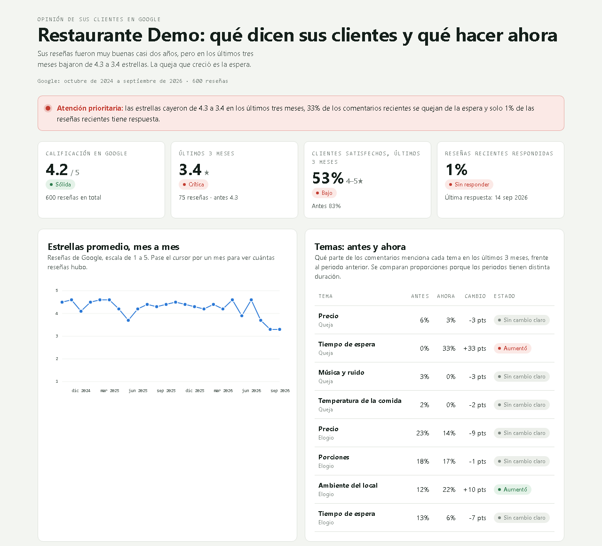
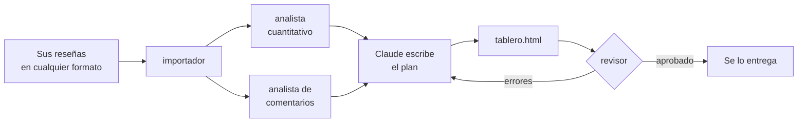

# Tagi Insights

**Lo que dicen sus clientes en Google, convertido en un plan de acción.**

Usted le dice a Claude dónde están guardadas las reseñas de su negocio y recibe un
tablero que se abre en el celular: cómo está su calificación, qué cambió, de qué se
quejan sus clientes, qué valoran y qué hacer primero. Sirve para cualquier negocio
(un restaurante, un taller, una peluquería, una clínica) y para reseñas en casi
cualquier formato.

Es un plugin gratuito para [Claude Code](https://claude.com/claude-code), hecho por
[Tagi](#necesita-ayuda).



*Tablero de ejemplo con datos inventados. Para verlo completo, descargue
[`examples/dashboard-ejemplo.html`](examples/dashboard-ejemplo.html) y ábralo con
doble clic.*

## Qué hace

- **Lee sus reseñas como vengan:** CSV, Excel, JSON de Google o texto copiado de
  Google Maps, con cualquier nombre de columna. Si algo no está claro (por ejemplo,
  qué día copió unas reseñas que dicen "hace 2 semanas"), le pregunta en vez de
  adivinar.
- **Compara lo reciente con lo anterior:** estrellas, clientes satisfechos y reseñas
  respondidas en los últimos tres meses frente a antes.
- **Lee cada comentario:** encuentra de qué se quejan y qué elogian sus clientes,
  qué creció y qué desapareció, y los detalles pequeños que la gente nota (la
  galleta con el café, el saludo al llegar).
- **Propone un plan:** qué hacer esta semana, este mes y siempre, cada acción con
  la cifra que la justifica.
- **Se revisa a sí mismo:** antes de entregarle nada, un revisor independiente
  vuelve a calcular cada cifra desde sus reseñas y comprueba que cada cita exista.
- **Le avisa cuando hay pocos datos:** con menos de 50 reseñas, menos de 10 en los
  últimos tres meses o menos de 20 comentarios, el tablero lo dice y las
  conclusiones son más prudentes.

## Instalar

Necesita:

- **Claude Code**, que requiere una suscripción de pago de Claude (Pro o Max) o una
  cuenta de la API.
- **Python 3.11 o más nuevo.** Si no lo tiene, descárguelo de
  [python.org](https://www.python.org/downloads/); en Windows, marque "Add
  python.exe to PATH" al instalarlo. Lo demás (pandas y openpyxl) se instala solo
  la primera vez que pide un tablero, en una carpeta aparte que no toca nada más de
  su computador.

En Claude Code, escriba:

```text
/plugin marketplace add https://github.com/MateoJara/tagi-insights-agent.git
/plugin install tagi@tagi
```

<!-- TODO(bloque D): instrucciones para Cowork, después de probarlo con el repo público. -->

## Usarlo

Adjunte el archivo de sus reseñas a la conversación y escriba:

```text
/tagi:informe
```

O, con sus palabras: *"estas son las reseñas de mi negocio, ¿qué dicen mis clientes?"*

Si prefiere, indique la carpeta donde las tiene:
`/tagi:informe C:\Users\usted\Documentos\mis-reseñas`.

Claude le irá contando qué hace en cada paso. Puede preguntarle el nombre del negocio
o algún dato de las reseñas. Al final le entrega el tablero, `tablero.html`. Se abre
con doble clic en cualquier navegador, también sin internet, y se puede enviar por
WhatsApp o correo como cualquier archivo.

## Cómo conseguir sus reseñas

**Si es el dueño del perfil de Google (recomendado).** Google le entrega todas sus
reseñas, con fecha exacta y sus respuestas:

1. Entre a [takeout.google.com](https://takeout.google.com) con la cuenta que
   administra su perfil de empresa.
2. Pulse "Anular la selección de todo" y marque solo **Perfil de Empresa de Google**
   (Google Business Profile).
3. Elija "Exportar una vez" y pida el enlace de descarga por correo.
4. Descomprima el archivo que le llega y ponga la carpeta en un lugar que recuerde.

Los nombres de los botones pueden cambiar un poco según el idioma y la versión de
Google.

<!-- TODO: probar el importador con un Reviews.json real de Takeout. -->

**Si no es el dueño, o quiere algo rápido.** Abra el negocio en Google Maps, vaya a
la pestaña de reseñas, ordénelas por "Más recientes", baje hasta cargar las que
quiera, selecciónelas, cópielas y péguelas en un archivo de texto. Anote el día en
que las copió: Google Maps muestra fechas como "hace 3 semanas", y Claude se lo va a
preguntar para ubicarlas en el calendario.

**Si ya las tiene en otra herramienta** (un Excel, un CSV exportado de otro
servicio), sirve tal cual.

## Sus datos

- Todo se guarda en su computador, en una carpeta `tagi` junto a sus reseñas (o en
  la carpeta de trabajo de la conversación, si las adjuntó). Los datos no pasan por
  Tagi.
- Claude lee sus reseñas para analizarlas, como en cualquier conversación con
  Claude. Revise la política de privacidad de su plan de Claude si eso le importa.
- Los nombres de quienes dejaron las reseñas nunca se copian: el importador los
  descarta antes del análisis.

## Cómo funciona



El plugin es una **skill** (`/tagi:informe`, las instrucciones del proceso) que
coordina cuatro **subagentes**, cada uno con su propio contexto y solo las
herramientas que necesita:

| Subagente | Modelo | Qué hace |
|---|---|---|
| `importador` | Sonnet | Decide qué es cada columna y escribe un plan de importación. Un script lo aplica con conversiones de una lista cerrada y probada. |
| `analista-cuantitativo` | Haiku | Corre el cálculo de las cifras. No interpreta. |
| `analista-comentarios` | Sonnet | Lee cada comentario y lo etiqueta por tema y tipo (queja, elogio, sugerencia). Un script valida y cuenta. |
| `revisor` | Sonnet | Recalcula cada cifra por su cuenta, sin usar el código del plugin, y no deja entregar nada hasta que todo cuadre. |

La regla de diseño: **el modelo decide, el código calcula y otro modelo verifica.**
Claude nunca escribe una cifra de memoria; todas salen de archivos que genera el
código, y el revisor las comprueba por un camino distinto.

## Cuánto cuesta

El plugin es gratis. Lo que se consume es el uso de Claude de su plan:

- **Instalado y sin usarse:** unos 400 tokens por sesión, lo que ocupan las
  descripciones de la skill y los subagentes.
- **Al pedir un tablero:** varios subagentes leen sus reseñas y el revisor las
  vuelve a leer, así que el consumo crece con el número de comentarios.

<!-- TODO: medir una corrida completa con 30 y con 600 reseñas y poner las cifras. -->

## ¿Necesita ayuda?

Tagi ayuda a negocios a entender a sus clientes. Escríbanos si:

- no sabe cómo instalarlo o usarlo,
- tiene pocas reseñas para sacar conclusiones y quiere conseguir más,
- o quiere llevar herramientas de IA como Claude Code a su negocio.

**Contacto:** [Mateo Jaramillo en LinkedIn](https://www.linkedin.com/in/mateo-jaramillo-londoño-b2a475226)

## Para desarrolladores

```text
.claude-plugin/   plugin.json y marketplace.json: el repo es el plugin y su catálogo
skills/informe/   la skill /tagi:informe y sus guías (criterios, textos del tablero)
agents/           los cuatro subagentes
tagi.py           punto de entrada: setup, ingest, metrics, comments, dashboard
src/              el análisis en Python (pandas)
tests/            pytest; fixtures con las respuestas conocidas de los datos de prueba
data/sample/      reseñas sintéticas y ejemplos de cada formato que se importa
examples/         el tablero de ejemplo y lo que lo produjo
```

```bash
python -m venv .venv
.venv/Scripts/python -m pip install -r requirements-dev.txt
.venv/Scripts/python -m pytest
```

En macOS y Linux, la ruta es `.venv/bin/python`.

Todos los datos del repo son **sintéticos**, generados con semilla fija
(`src/generate_sample_data.py`). Cada conjunto de prueba trae su respuesta conocida
en `tests/fixtures/`, lo que permite medir a los subagentes y no solo al código.

Para probar cambios en la skill o los subagentes, instale el plugin desde su copia
local (`claude plugin marketplace add ./ --scope local` y
`claude plugin install tagi@tagi --scope local`) y use `/reload-plugins` después de
cada cambio.

## Licencia

[MIT](LICENSE): puede usarlo, modificarlo y compartirlo libremente, también con
fines comerciales, siempre que conserve el aviso de la licencia.

---

### In English

Tagi Insights is a free Claude Code plugin that turns a business's Google reviews,
in whatever format they come (CSV, Excel, Google's JSON export or text pasted from
Google Maps), into a mobile-friendly dashboard with what customers say and a
prioritized action plan. It is built as one skill orchestrating four subagents: an
importer that maps unknown formats to a fixed schema through a closed list of
tested conversions, a quantitative analyst (Haiku), a comment analyst that labels
every review by reading it (Sonnet), and an independent reviewer that recomputes
every figure without the plugin's code before anything is delivered. The analysis
is plain pandas with a pytest suite, synthetic data with known answers, and a hook
that runs the tests after each code edit. The output is in Spanish.
