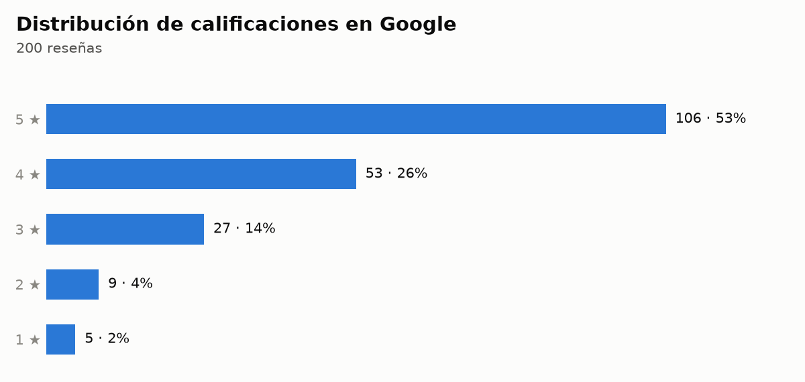
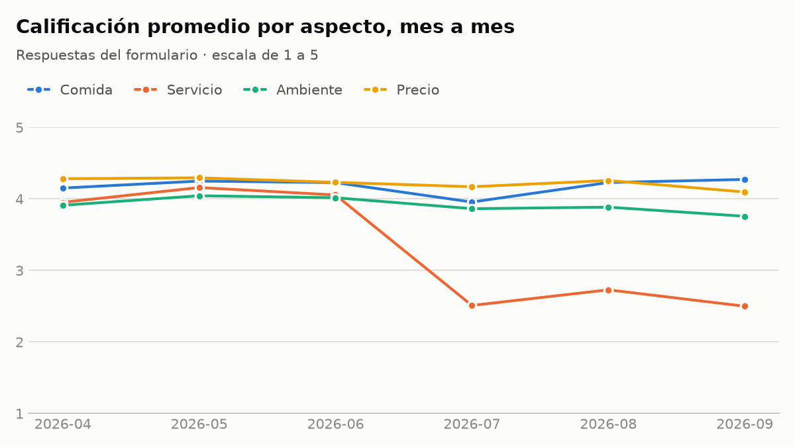
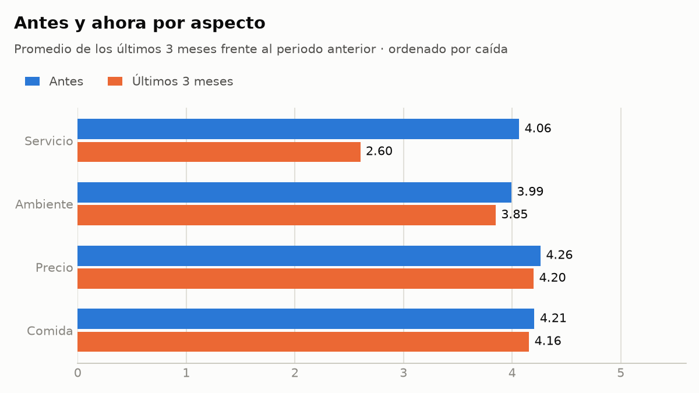

# Informe de insights: Restaurante Demo

> Ejemplo generado con datos sintéticos. El restaurante y sus clientes no existen.
> Este es el documento interno de Tagi. Lo que recibe el dueño es el tablero:
> [dashboard-ejemplo.html](dashboard-ejemplo.html).

**Periodo del formulario:** abril a septiembre de 2026 · 294 respuestas
**Reseñas de Google:** octubre de 2024 a septiembre de 2026 · 200 reseñas

## Resumen

Su comida y sus precios siguen gustando, pero la atención se deterioró desde julio
de 2026 y ya se nota en Google: sus reseñas de los últimos tres meses promedian 3.3
frente a 4.2 en el histórico. Lo primero es recuperar el servicio y volver a
responder las reseñas: solo 8% de las recientes tiene respuesta.

## 1. Cómo está el negocio hoy

| Métrica | Valor | Lectura |
|---|---|---|
| Calificación general (formulario) | 3.9 de 5 | Aceptable, pero por debajo de 4.0. Base: 286 respuestas. |
| Clientes satisfechos | 71% | Siete de cada diez califican la visita con 4 o 5. Base: 286 respuestas. |
| Recomendación (NPS) | -4 | Hay un poco más de clientes que no lo recomendarían que clientes que sí. Base: 287 respuestas. |
| Calificación en Google | 4.2 de 5 | Sólida, sobre el umbral de 4.0. Base: 200 reseñas. |
| Google, últimos 3 meses | 3.3 de 5 | Por debajo de 4.0. Base: 26 reseñas. Es la alerta principal. |
| Reseñas respondidas | 27% histórico, 8% reciente | Última respuesta: 28 de agosto de 2026. |

El NPS mide qué tanto lo recomendarían sus clientes: resta el porcentaje que
responde de 0 a 6 al porcentaje que responde 9 o 10. Va de -100 a 100.

El promedio reciente importa más que el histórico porque es lo que lee quien está
decidiendo hoy dónde comer. Como referencia de otros mercados, una encuesta de 2026
en Estados Unidos encontró que 74% de los consumidores busca reseñas de los últimos
tres meses y 68% solo considera negocios de 4 estrellas o más.

## 2. Qué cambió

La atención es lo único que cambió de forma importante. Pasó de 4.0 a 2.6 en los
últimos tres meses, una caída de 1.4 puntos (base: 144 respuestas antes y 139 en
los últimos tres meses).

La caída fue de un mes a otro, no gradual:

| Mes de 2026 | Servicio | General |
|---|---|---|
| Abril | 3.9 | 4.0 |
| Mayo | 4.1 | 4.1 |
| Junio | 4.1 | 4.1 |
| Julio | 2.5 | 3.6 |
| Agosto | 2.7 | 3.8 |
| Septiembre | 2.5 | 3.6 |

Los otros tres aspectos casi no se movieron:

El mismo deterioro ya es visible para el público: las reseñas recientes de Google
bajaron a 3.3, y solo 8% de las 26 tiene respuesta suya.

## Qué dicen los comentarios

Se analizaron 290 comentarios del formulario y de Google; 125 son de los últimos
tres meses. De los 290, 21 no dicen nada concreto ("Excelente", "Muy mal") y se
cuentan aparte.

**De qué se quejan**

| Queja | Menciones | Antes | Últimos 3 meses |
|---|---|---|---|
| Tiempo de espera | 23 | 1 | 22 |
| Trato del personal | 11 | 1 | 10 |
| Exactitud del pedido | 5 | 2 | 3 |

El tercer lugar es un empate en 5 menciones: pedidos o cuentas equivocados, ruido y
música (2 recientes) y sabor de la comida (ninguna reciente).

Las quejas por espera y por el trato son casi todas recientes y coinciden con la
caída de la calificación de servicio. Es la pista más concreta sobre qué arreglar:

> "Lástima, el pedido tardó casi una hora. No creo que vuelva"

> "Pasaron 20 minutos antes de que alguien se acercara a la mesa"

El mismo tema aparecía antes como elogio: 20 comentarios destacan la rapidez, pero
solo 3 son de los últimos tres meses. Con el trato pasa igual: 19 elogios, solo 2
recientes.

**Qué valoran**

| Elogio | Menciones | Últimos 3 meses |
|---|---|---|
| Tamaño de porciones | 46 | 20 |
| Precio y valor | 41 | 15 |
| Sabor de la comida | 23 | 7 |

**Detalles pequeños que sus clientes notan**

- **La galleta con el café:** 19 elogios (11 antes, 8 en los últimos tres meses).
  Cuesta poco y la mencionan sin que nadie pregunte: "El detalle de la galleta con
  el tinto me pareció muy lindo. volveré". Conviene mantenerla.
- **El saludo y el agradecimiento:** 2 quejas, ambas recientes: "Nadie saluda ni da
  las gracias. Ojalá mejoren". Son pocas menciones, pero es de lo más fácil de recuperar.

**Lo que le sugieren**

- Menú con código QR: 10 menciones, 8 de ellas recientes.
- Más personal a la hora del almuerzo: 8 menciones, 5 recientes. Apunta en la misma
  dirección que las quejas por espera.
- Abrir los domingos: 6. Menú infantil: 6.

## 3. Qué funciona y hay que proteger

- **Precio:** 4.2 de 5. Es su aspecto mejor calificado; pasó de 4.3 a 4.2. En los
  comentarios es el segundo elogio más frecuente (41 menciones).
- **Comida:** 4.2 de 5. Pasó de 4.2 a 4.1. Lo que más elogian es el tamaño de las
  porciones (46 menciones); el sabor suma 23 elogios.
- **Ambiente:** 3.9 de 5. Pasó de 4.0 a 3.8.

Sus clientes siguen valorando lo que sirve y lo que cobra. Al corregir la atención,
no toque la carta ni los precios.

## 4. En qué concentrarse

1. **Recuperar la atención, empezando por los tiempos de espera.** El servicio es el
   único aspecto que cayó (de 4.0 a 2.6) y arrastra la calificación general, que
   bajó de 4.1 en junio a 3.6 en septiembre. La espera es la queja más repetida: 23
   menciones, 22 de ellas recientes.
2. **Volver a responder las reseñas.** Antes respondía 30% (base: 174 reseñas) y en
   los últimos tres meses 8% (base: 26), justo cuando llegaron las más críticas.

## 5. Plan de acción

### Esta semana

- **Responda las reseñas de los últimos tres meses, empezando por las negativas.**
  Agradezca, reconozca la mala experiencia sin discutir y diga qué va a cambiar.
  Evite respuestas de plantilla.
  *Por qué:* solo 8% de las 26 reseñas recientes tiene respuesta.
  *Cómo medirlo:* porcentaje de reseñas recientes respondidas en el próximo informe.
- **Revise qué cambió en el equipo o en los turnos hacia julio.** Vea las preguntas
  al final.
  *Por qué:* la atención pasó de 4.1 en junio a 2.5 en julio, de un mes a otro.

### Este mes

- **Reduzca los tiempos de espera.** Si hubo personal nuevo: entrénelo y repártalo
  entre turnos en lugar de concentrarlo. Si falta gente en horas pico: refuerce esos
  turnos; 8 clientes sugieren más personal a la hora del almuerzo. Son sugerencias
  habituales del sector; usted sabe cuál aplica.
  *Por qué:* servicio en 2.6 en los últimos tres meses y 22 quejas recientes por espera.
  *Cómo medirlo:* la calificación mensual de servicio debe volver a acercarse a 4.0
  y las quejas por espera deben bajar.
- **Atienda las quejas del formulario como oportunidades.** Un cliente que se queja
  ahí todavía no ha escrito en Google.
  *Cómo medirlo:* calificación reciente en Google de vuelta sobre 4.0.

### Continuo

- **Asigne a una persona la tarea de responder todas las reseñas cada semana.**
  *Por qué:* la última respuesta fue el 28 de agosto de 2026.
- **Mantenga la galleta con el café y recupere el saludo.** Son detalles que cuestan
  poco y que sus clientes notan.
  *Por qué:* 19 elogios a la galleta; 2 quejas recientes porque nadie saluda.
- **Invite a todos sus clientes a dejar su opinión**, sin filtrar a los contentos y
  sin ofrecer nada a cambio. Google prohíbe los incentivos por reseñas.

## 6. El siguiente nivel

Cuando la atención vuelva a su nivel de antes, el siguiente umbral en Google es 4.5.
Su ventaja para llegar ahí es clara: precio y comida en 4.2. Conviértalos en mensaje
en su perfil de Google y en sus redes. El aspecto con más margen después del
servicio es el ambiente, en 3.9.

## Preguntas para usted

1. ¿Hubo cambios de personal, de administrador o de turnos entre junio y julio de 2026?
2. ¿Aumentó el número de clientes en esos meses sin aumentar el equipo, sobre todo
   a la hora del almuerzo?
3. ¿Quién maneja hoy el perfil de Google del restaurante?

## Sobre estos datos

- Formulario: 300 respuestas leídas, 6 duplicadas eliminadas, 294 analizadas.
- Google: 200 reseñas analizadas; 42% trae texto.
- Comentarios: 290 analizados. Cada uno se clasificó por tema leyéndolo; un mismo
  comentario puede contar en dos temas. Las citas son textuales.
- Este informe no conoce sus ventas, costos ni ocupación, y no estima impacto en
  dinero. Quien responde un formulario o deja una reseña no representa a todos sus
  clientes.
- Las causas mencionadas son hipótesis. Los datos muestran qué pasó y cuándo, no por qué.
