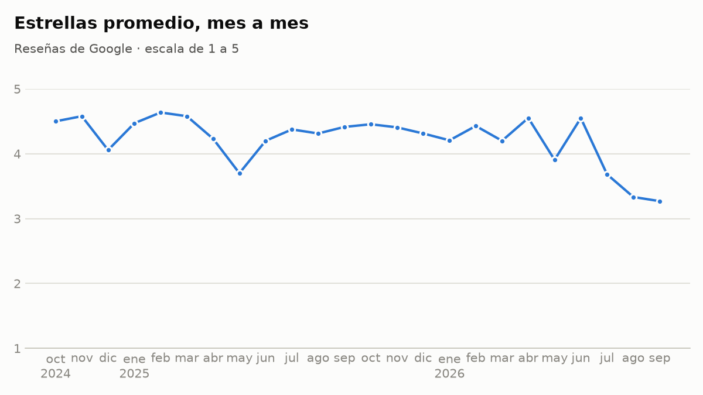
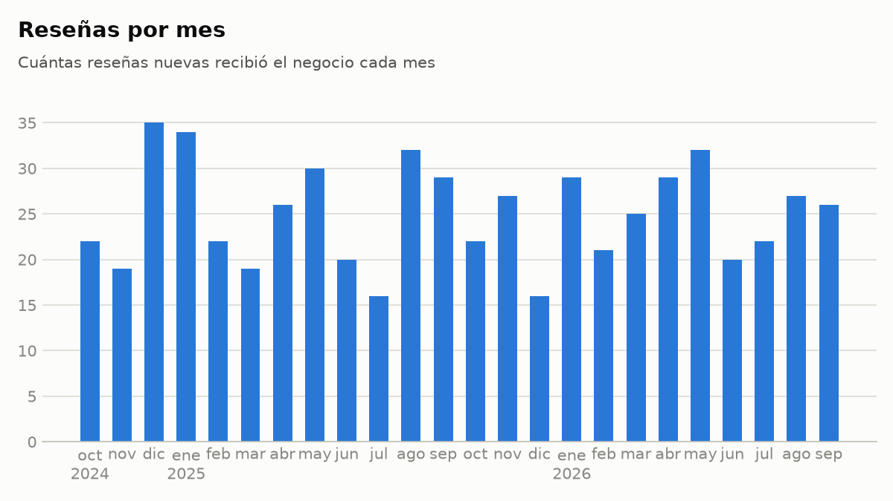

# Informe de insights: Restaurante Demo

> Ejemplo generado con datos sintéticos. El restaurante y sus clientes no existen.
> Este es el documento interno de Tagi. Lo que recibe el dueño es el tablero:
> [dashboard-ejemplo.html](dashboard-ejemplo.html).

**Reseñas de Google:** octubre de 2024 a septiembre de 2026 · 600 reseñas, 304 con
comentario

## Resumen

Sus reseñas fueron muy buenas durante casi dos años, pero en los últimos tres meses
bajaron de 4.3 a 3.4 estrellas, y en los comentarios aparece una queja que antes casi
no existía: la espera. Lo primero es reducir los tiempos de espera y volver a
responder las reseñas, que hoy casi no tienen respuesta.

## 1. Cómo está el negocio hoy

| Métrica | Antes | Últimos 3 meses | Lectura |
|---|---|---|---|
| Estrellas promedio | 4.3 | 3.4 | Cayó 0.9, y quedó por debajo de 4.0. |
| Clientes satisfechos (4 y 5 estrellas) | 83% | 53% | Bajó 30 puntos: casi la mitad de las reseñas recientes son de 3 estrellas o menos. |
| Reseñas respondidas por el dueño | 38% | 1% | Respondió una de las 75 recientes; la última respuesta fue el 14 de septiembre de 2026. |
| Base | 525 reseñas | 75 reseñas | |

El promedio total, el que Google muestra, todavía es 4.2 (600 reseñas), porque los
casi dos años buenos pesan mucho. Pero quien busca un restaurante mira las reseñas
recientes. Como referencia de otros mercados, una encuesta de 2026 en Estados Unidos
encontró que 74% de los consumidores busca reseñas de los últimos tres meses y 68%
solo considera negocios de 4 estrellas o más.

## 2. Qué cambió

Las estrellas se mantuvieron casi siempre por encima de 4 hasta junio de 2026 y
cayeron en los tres meses siguientes:

| Mes de 2026 | Reseñas | Estrellas promedio |
|---|---|---|
| Julio | 22 | 3.7 |
| Agosto | 27 | 3.3 |
| Septiembre | 26 | 3.3 |

Lo que no cambió es cuántas reseñas recibe: entre 22 y 27 al mes en ese periodo,
dentro del rango de los meses anteriores (de 16 a 35). No es que lleguen menos
clientes a opinar; es que opinan peor.

Dos meses anteriores también bajaron de 4 (mayo de 2025 y mayo de 2026) y se
recuperaron al mes siguiente. Por eso un solo mes malo no es alarma; tres seguidos sí.

## Qué dicen los comentarios

Se analizaron 304 comentarios: 268 de antes y 36 de los últimos tres meses. De los
304, 23 no dicen nada concreto ("Excelente", "Todo bien") y se cuentan aparte. Como los
periodos tienen distinta duración, se comparan proporciones: qué parte de los
comentarios de cada periodo menciona un tema.

**De qué se quejan**

| Queja | Antes | Últimos 3 meses |
|---|---|---|
| Tiempo de espera | 1 de 268 (0%) | 12 de 36 (33%) |
| Precio | 16 de 268 (6%) | 1 de 36 (3%) |
| Música y ruido | 7 de 268 (3%) | 0 |

La espera es la queja que más creció, y lo hizo justo cuando cayeron las
estrellas: uno de cada tres comentarios recientes la menciona. Otras dos quejas
también subieron en proporción, pero con una o dos menciones recientes, muy pocas
para sacar conclusiones: atención del personal (de 0% a 6%) y errores en el pedido
o la cuenta (de 1% a 3%).

> "Primera vez que vengo y sirven bastante, pero se demoran demasiado en atender"

> "La verdad muy buena relación calidad-precio, pero la espera fue eterna"

Las dos citas elogian algo antes de quejarse: las porciones y el precio siguen gustando.

**Qué valoran**

| Elogio | Antes | Últimos 3 meses |
|---|---|---|
| Precio | 23% | 14% |
| Porciones | 18% | 17% |
| Ambiente del local | 12% | 22% |
| Rapidez del servicio | 13% | 6% |
| Galleta de cortesía | 13% | 3% |

La rapidez, que antes se elogiaba en 13% de los comentarios, bajó a 6% (2 menciones
recientes).

**Detalles pequeños que sus clientes notan**

- **La galleta con el café:** 35 elogios, pero 34 son de antes y solo 1 de los
  últimos tres meses. Puede que se haya dejado de dar, o solo que ahora hay menos
  reseñas contentas. Con 36 comentarios recientes no se puede saber: hay que
  preguntarlo.
- **El saludo:** una sola queja, anterior al periodo reciente ("Nadie saluda ni da
  las gracias"). Es poco, pero es de lo más barato de cuidar.

No hubo sugerencias concretas en los comentarios.

## 3. Qué funciona y hay que proteger

- **Las porciones:** se elogian igual antes y ahora (18% y 17%).
- **El ambiente:** sube de 12% a 22% de los comentarios recientes.
- **El precio:** sigue siendo el elogio más repetido en el total (66 menciones),
  aunque baja de 23% a 14%.

Sus clientes siguen valorando lo que sirve, lo que cobra y el lugar. Al corregir la
atención, no toque la carta ni los precios.

## 4. En qué concentrarse

1. **Reducir los tiempos de espera.** Las estrellas bajaron de 4.3 a 3.4 y la espera
   pasó de 0% a 33% de los comentarios en el mismo periodo.
2. **Volver a responder las reseñas.** De 38% respondidas a 1%, justo cuando llegan
   las más críticas.

## 5. Plan de acción

### Esta semana

- **Responda las reseñas de los últimos tres meses, empezando por las negativas.**
  Agradezca, reconozca la mala experiencia sin discutir y diga qué va a cambiar.
  Evite respuestas de plantilla.
  *Por qué:* 1% de las 75 reseñas recientes tiene respuesta.
  *Cómo medirlo:* porcentaje de reseñas recientes respondidas en el próximo informe.
- **Revise qué cambió hacia julio de 2026.** Vea las preguntas al final.
  *Por qué:* las estrellas pasaron de estar casi siempre sobre 4 a 3.7 en julio y
  3.3 en agosto y septiembre.

### Este mes

- **Reduzca los tiempos de espera.** Si hubo personal nuevo: entrénelo y repártalo
  entre turnos. Si falta gente en horas pico: refuerce esos turnos. Son sugerencias
  habituales del sector; usted sabe cuál aplica.
  *Por qué:* 33% de los comentarios recientes se quejan de la espera.
  *Cómo medirlo:* esa proporción debe bajar y las estrellas mensuales volver a 4.

### Continuo

- **Asigne a una persona la tarea de responder todas las reseñas cada semana.**
  *Por qué:* antes respondía 38%; ahora 1%.
- **Mantenga la galleta con el café**, si se dejó de dar, recupérela. Es barata y
  sus clientes la mencionan sin que nadie pregunte.
  *Por qué:* 35 elogios en total.
- **Invite a todos sus clientes a dejar su opinión**, sin filtrar a los contentos y
  sin ofrecer nada a cambio. Google prohíbe los incentivos por reseñas.

## 6. El siguiente nivel

Cuando la atención vuelva a su nivel de antes, el objetivo es que las reseñas
recientes vuelvan a superar 4.0 y luego se acerquen a 4.5. Su ventaja para lograrlo
son las porciones y el ambiente, que sus clientes siguen elogiando: conviértalos en
mensaje en su perfil de Google y en sus redes.

## Preguntas para usted

1. ¿Hubo cambios de personal, de administrador o de turnos alrededor de julio de 2026?
2. ¿Aumentó el número de clientes en esos meses sin aumentar el equipo?
3. ¿Se sigue dando la galleta con el café?
4. ¿Quién maneja hoy el perfil de Google del restaurante?

## Sobre estos datos

- 600 reseñas leídas, ninguna duplicada; 304 traen comentario.
- Cada comentario se clasificó por tema leyéndolo; un mismo comentario puede contar
  en dos temas. Las citas son textuales.
- Los últimos tres meses tienen 36 comentarios: un cambio de pocas menciones en ese
  periodo mueve mucho las proporciones.
- Este informe no conoce sus ventas, costos ni ocupación. Quien deja una reseña no
  representa a todos sus clientes: escriben más los muy contentos y los muy molestos.
- Las causas mencionadas son hipótesis. Los datos muestran qué pasó y cuándo, no por qué.
